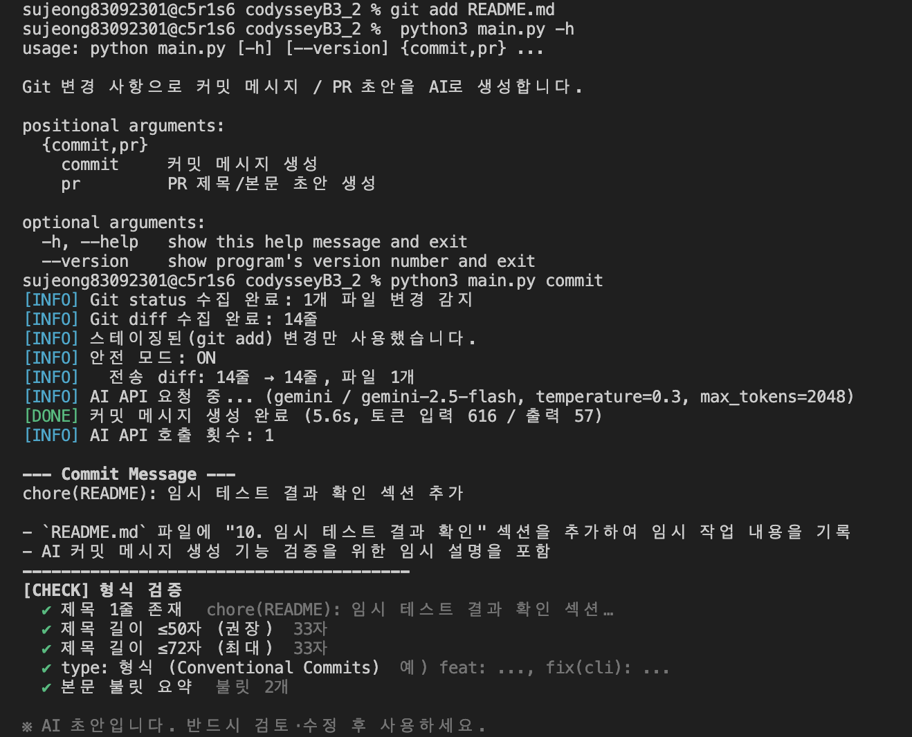
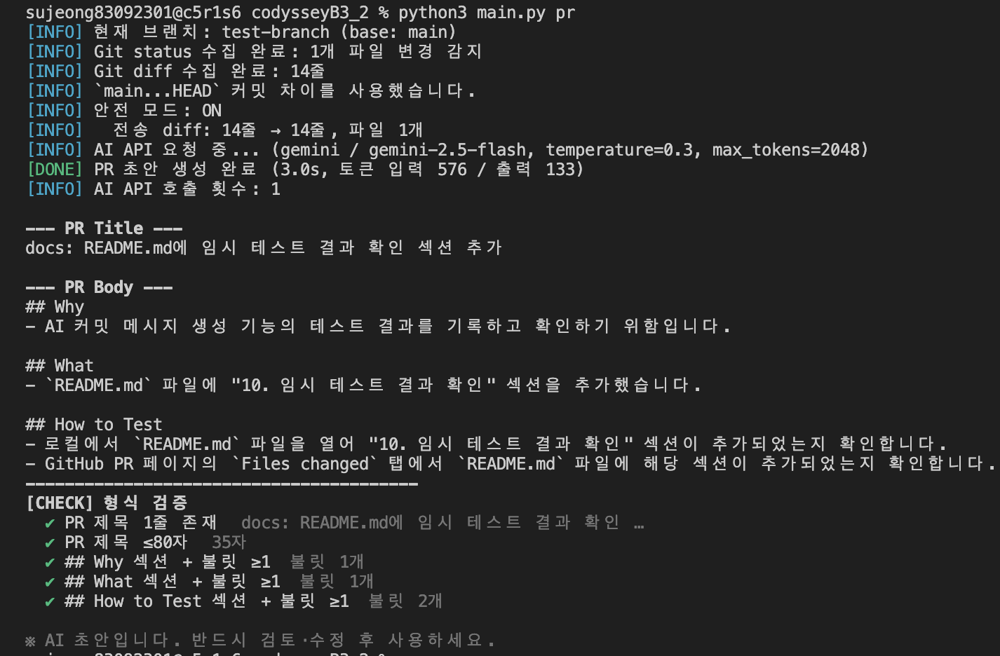
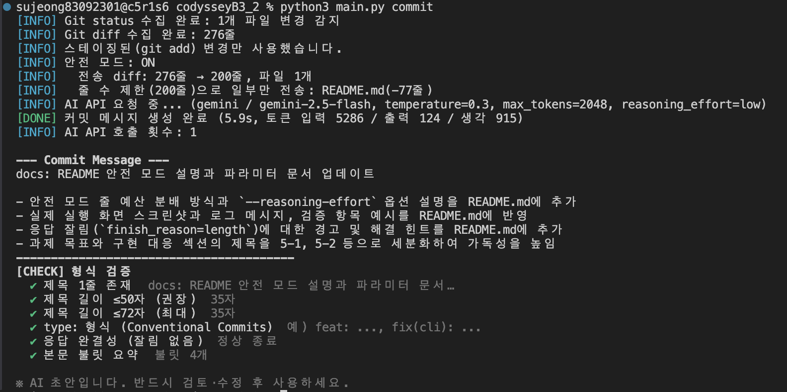

# ai-gitgen — AI 기반 Git 커밋 / PR 초안 생성기

`git status` · `git diff` 결과를 AI API에 보내 **커밋 메시지**와 **PR 제목·본문 초안**을 만들어 주는 터미널 도구입니다.
단순 호출이 아니라 **프롬프트(형식·규칙·컨텍스트) 설계 → 1회 호출 → 형식 검증·후처리**까지 한 번에 동작합니다.

```
git status / git diff  →  안전 모드(마스킹·전송 제한)  →  프롬프트 구성  →  AI API 1회 호출  →  검증·후처리  →  터미널 출력
```

- **외부 라이브러리 0개**: Python 표준 라이브러리(`urllib`, `subprocess`, `argparse`)만 쓰기 때문에 `pip install`이 필요 없습니다.
- **AI 제공자 3종**: Gemini(기본, 무료 키) / OpenAI / Anthropic 지원, 그 밖의 OpenAI 호환 서버는 `--base-url`로 연결
- **호출은 명령당 정확히 1회**: 자동 재시도가 없고 호출 횟수를 로그로 출력합니다.
- **안전 모드 기본 ON**: API Key·토큰·비밀번호·이메일·전화번호를 마스킹하고, 최대 10파일·200줄까지만 전송합니다. 줄 예산은 파일마다 공평하게 나눕니다.

---

## 1. 설치

필요한 것: **Python 3.10 이상** (3.9에서도 동작), **Git**

```bash
python3 --version          # 3.10 이상인지 확인
git clone https://github.com/SJendministrator/codysseyB3_2.git
cd codysseyB3_2
python3 main.py -h         # 도움말이 나오면 설치 끝 (pip install 불필요)
```

## 2. API Key 설정 (환경변수)

키는 **환경변수로만** 받습니다. 코드나 설정 파일에는 절대 넣지 않습니다. 설정 파일에 키를 넣으면 실행이 거부됩니다.

| 제공자 | 키 발급 | 비고 |
|---|---|---|
| `gemini` (기본) | https://aistudio.google.com/apikey | 카드 없이 무료 키 발급 |
| `openai` | https://platform.openai.com/api-keys | 유료 |
| `anthropic` | https://console.anthropic.com/settings/keys | 유료 |

```bash
# 현재 터미널 세션에만 설정 (공용 PC라면 이 방법을 권장: 창을 닫으면 사라짐)
export AI_API_KEY="발급받은_키"

# (선택) 제공자/모델 기본값도 환경변수로
export AI_PROVIDER=gemini        # gemini | openai | anthropic
export AI_MODEL=gemini-2.5-flash
```

> `AI_API_KEY`가 없으면 제공자별 변수(`GEMINI_API_KEY`, `OPENAI_API_KEY`, `ANTHROPIC_API_KEY`)도 찾아봅니다.
> 개인 PC에서만 `~/.zshrc`에 넣으세요. 공용 PC에 넣으면 다음 사람이 그 키를 씁니다.

## 3. 사용법

**반드시 대상 프로젝트의 Git 루트에서 실행합니다.**

```bash
# 이 저장소 자체에서
python3 main.py commit
python3 main.py pr

# 다른 프로젝트에서 쓰기: 그 프로젝트 루트로 이동한 뒤 main.py 경로를 지정
cd ~/codysseyB3_1
python3 ~/codysseyB3_2/main.py commit

# 자주 쓰면 alias 등록
alias gitgen="python3 ~/codysseyB3_2/main.py"
gitgen pr --base main
```

### 자주 쓰는 예시

```bash
gitgen commit                                    # 스테이징된 변경(없으면 워킹트리 전체)으로 커밋 메시지 생성
gitgen commit -c "로그인 실패 시 재시도 로직 요청사항 반영"   # 변경 이유를 알려주면 품질이 올라감
gitgen commit -o msg.txt && git commit -F msg.txt   # 파일로 저장 → 검토 후 그대로 커밋
gitgen pr --base main -o pr.md                   # main 대비 현재 브랜치 변경으로 PR 초안
gitgen commit --dry-run                          # API를 호출하지 않고 보낼 프롬프트만 확인 (무료)
gitgen commit -m gemini-2.5-flash -t 0.1 --max-tokens 1024   # 파라미터 변경
gitgen commit --provider anthropic               # 다른 제공자
```

### 옵션

| 옵션 | 기본값 | 설명 |
|---|---|---|
| `--provider` | `gemini` | `gemini` / `openai` / `anthropic` |
| `--model`, `-m` | 제공자별 기본 | gemini `gemini-2.5-flash`, openai `gpt-4.1-mini`, anthropic `claude-haiku-5-5` |
| `--temperature`, `-t` | `0.3` | 0~2. 낮을수록 같은 diff에 같은 결과 (커밋 메시지엔 낮게) |
| `--max-tokens` | `2048` | 응답 최대 토큰. 넘으면 응답이 잘림 |
| `--reasoning-effort` | gemini `low` / 그 외 `off` | 추론(thinking) 모델의 생각 분량 `none`·`low`·`medium`·`high`, `off`면 요청에 넣지 않음 |
| `--timeout` | `60` | 요청 타임아웃(초) |
| `--base-url` | — | OpenAI 호환 서버 주소 직접 지정 |
| `--context`, `-c` | — | 변경 이유·요구사항을 프롬프트에 함께 전달 |
| `--lang` | `ko` | 출력 언어 `ko` / `en` |
| `--output`, `-o` | — | 결과를 파일로 저장 |
| `--dry-run` | — | 프롬프트만 출력, API 호출 0회 |
| `--show-prompt` | — | 호출 전에 프롬프트도 같이 출력 |
| `--safe-mode` / `--no-safe-mode` | ON | 민감정보 마스킹 + 전송 제한 |
| `--max-files` / `--max-lines` | `10` / `200` | 안전 모드 전송 한도 (줄 예산은 파일마다 공평 분배) |
| `--base` (pr) | 자동 | 비교 기준 브랜치 (`main` → `master` → `origin/main` 순서로 탐지) |
| `--config` | `./.ai-gitgen.json` | 설정 파일 (있으면 자동 로드) |

설정 우선순위: **기본값 < 설정 파일 < 환경변수 < CLI 옵션**

## 4. 출력 예시

### 실제 실행 화면 (Gemini `gemini-2.5-flash`)

| `python3 main.py commit` | `python3 main.py pr` |
|---|---|
|  |  |

- commit: `git add`한 파일만 수집 → API 1회 호출(5.6s, 입력 616 / 출력 57 토큰) → 형식 검증 통과
- pr: `main...HEAD` 차이 수집 → API 1회 호출(3.0s) → Why / What / How to Test 섹션과 불릿 검증 통과

아래는 출력 형식을 텍스트로 옮긴 예시입니다.

### 커밋 메시지 (`python3 main.py commit`)

```
[INFO] Git status 수집 완료: 2개 파일 변경 감지
[INFO] Git diff 수집 완료: 19줄
[INFO] 스테이징된 변경이 없어 워킹트리 전체(새 파일 포함)를 사용했습니다.
[INFO] 안전 모드: ON
[INFO]   전송 diff: 19줄 → 19줄, 파일 2개
[INFO]   마스킹: SLACK_TOKEN 1건, EMAIL 1건
[INFO] AI API 요청 중... (gemini / gemini-2.5-flash, temperature=0.3, max_tokens=2048, reasoning_effort=low)
[DONE] 커밋 메시지 생성 완료 (1.8s, 토큰 입력 412 / 출력 58 / 생각 310)
[INFO] AI API 호출 횟수: 1

--- Commit Message ---
feat(app): hello 함수에 이름 인자 추가

- app.py: hello(name)으로 시그니처 변경
- config.py: 알림 설정 파일 추가
----------------------------------------
[CHECK] 형식 검증
  ✔ 제목 1줄 존재  feat(app): hello 함수에 이름 인자 추가
  ✔ 제목 길이 ≤50자 (권장)  29자
  ✔ 제목 길이 ≤72자 (최대)  29자
  ✔ type: 형식 (Conventional Commits)  예) feat: ..., fix(cli): ...
  ✔ 응답 완결성 (잘림 없음)  정상 종료
  ✔ 본문 불릿 요약  불릿 2개

※ AI 초안입니다. 반드시 검토·수정 후 사용하세요.
```

### PR 초안 (`python3 main.py pr`)

```
[INFO] 현재 브랜치: feature/commit-pr-generator (base: main)
[INFO] Git status 수집 완료: 1개 파일 변경 감지
[INFO] Git diff 수집 완료: 9줄
[INFO] `main...HEAD` 커밋 차이를 사용했습니다.
[INFO] 안전 모드: ON
[INFO]   전송 diff: 9줄 → 9줄, 파일 1개
[INFO] AI API 요청 중... (gemini / gemini-2.5-flash, temperature=0.3, max_tokens=2048, reasoning_effort=low)
[DONE] PR 초안 생성 완료 (2.3s, 토큰 입력 530 / 출력 121 / 생각 402)
[INFO] AI API 호출 횟수: 1

--- PR Title ---
feat: hello 함수에 이름 인자 추가

--- PR Body ---
## Why
- 사용자 이름을 넣은 인사 문구가 필요했습니다.

## What
- `app.py`: `hello()` → `hello(name)` 시그니처 변경
- 반환 문자열을 f-string으로 변경

## How to Test
- `python -c "from app import hello; print(hello('쥭'))"` 실행
- 출력이 `hello 쥭` 인지 확인
----------------------------------------
[CHECK] 형식 검증
  ✔ PR 제목 1줄 존재  feat: hello 함수에 이름 인자 추가
  ✔ PR 제목 ≤80자  24자
  ✔ 응답 완결성 (잘림 없음)  정상 종료
  ✔ ## Why 섹션 + 불릿 ≥1  불릿 1개
  ✔ ## What 섹션 + 불릿 ≥1  불릿 2개
  ✔ ## How to Test 섹션 + 불릿 ≥1  불릿 2개
```

### 오류 / 예외 상황

```
$ python3 main.py commit            # 변경 없음
[INFO] 변경 사항이 없습니다. 커밋 메시지를 생성하지 않고 종료합니다.

$ python3 main.py commit            # 키 없음
[ERROR] AI_API_KEY 환경변수가 설정되지 않았습니다.
## 예) export AI_API_KEY="YOUR_KEY"
키 발급: https://aistudio.google.com/apikey

$ python3 main.py commit            # 키가 틀림
[ERROR] API 호출 실패 (HTTP 401 인증 실패): Incorrect API key provided
## API Key가 틀렸거나 만료됐습니다. AI_API_KEY 값과 --provider 가 맞는지 확인하세요.

$ python3 main.py commit            # 인터넷 끊김
[ERROR] 네트워크 오류: [Errno 8] nodename nor servname provided, or not known
## 인터넷 연결, 프록시/방화벽, --base-url 주소를 확인하세요.

$ cd src && python3 ../main.py commit   # 루트가 아닌 곳
[ERROR] 프로젝트 루트에서 실행해야 합니다.
```

| HTTP / 상황 | 메시지 | 안내 |
|---|---|---|
| 400 | 잘못된 요청 | 모델 이름·파라미터 확인 |
| 401 / 403 | 인증 실패 / 권한 없음 | 키·제공자·결제 상태 확인 |
| 404 | 찾을 수 없음 | 모델 이름 / `--base-url` 확인 |
| 429 | 요청 한도 초과 | 무료 할당량 초과, 잠시 후 재시도 |
| 5xx | 서버 오류 | 제공자 일시 장애 |
| 타임아웃 / DNS / SSL | 원인별 메시지 | `--timeout`, 네트워크, macOS 인증서 설치 안내 |
| 응답 잘림 (`finish_reason=length`) | `[WARN]` + `⚠ 응답 완결성` | 끊긴 마지막 줄을 버리고 출력, `--max-tokens` / `--reasoning-effort none` 안내 |
| 빈 응답 | `finish_reason` 표시 | thinking 모델이면 `--max-tokens` 증가 / `--reasoning-effort none` 안내 |

---

## 5. 과제 목표와 구현 (동작 원리)

미션의 과제 목표 5가지를 각각 어떻게 이해했고, 어느 코드에 구현했는지 정리합니다. `> 코드:` 줄의 `[번호]`는 각 파일 안의 구분 주석 번호입니다.

### 5-1. AI API를 REST 방식으로 연동하는 흐름 (요청 → 응답 → 예외)

> 코드: `gitgen/ai_client.py` — `[4] 요청 만들기`, `[6] 호출 함수`

AI API 호출은 결국 **HTTPS로 JSON을 POST하고 JSON을 돌려받는 것**입니다. SDK 없이 `urllib`로 직접 구현해서 각 단계를 눈으로 확인할 수 있게 했습니다.

| 단계 | 하는 일 | 구현 |
|---|---|---|
| 요청 구성 | 엔드포인트 URL, 인증 헤더, JSON 본문(`model`, `messages`, `temperature`, `max_tokens`) 조립 | `_build_http_request()` — OpenAI 호환은 `Authorization: Bearer`, Anthropic은 `x-api-key` |
| 전송 | POST 1회, 타임아웃 지정 | `urllib.request.urlopen(req, timeout=)` |
| 응답 처리 | JSON 파싱 → 제공자별 위치에서 텍스트·토큰 사용량·종료 사유 추출 | OpenAI 호환 `choices[0].message.content` / Anthropic `content[].text` |
| 예외 대응 | 실패 원인을 사용자가 알아듣게 변환 | `HTTPError`(400·401·403·404·429·5xx), `URLError`(DNS·연결·SSL), 타임아웃, JSON 오류, 빈 응답 → `[ERROR] 원인` + `## 해결 힌트` |

자동 재시도는 일부러 넣지 않았습니다. 그래서 명령 1번이 항상 호출 1번이고, 비용을 예측할 수 있습니다.

### 5-2. temperature, max_tokens 등 파라미터가 품질에 주는 영향

> 코드: `gitgen/cli.py` — `[4] CLI 인자 정의` (`--model`, `--temperature`, `--max-tokens`, `--reasoning-effort`)

| 파라미터 | 역할 | 낮게 / 작게 | 높게 / 크게 | 선택한 기본값 |
|---|---|---|---|---|
| `temperature` | 다음 단어를 고를 때의 무작위성 | 같은 diff에 거의 같은 결과, 형식을 잘 지킴 | 표현은 다양해지지만 형식 이탈·없는 내용 생성 위험 증가 | **0.3** — 커밋/PR은 창의성보다 정확성 |
| `max_tokens` | 응답 길이 상한 | 응답이 중간에 잘림 (`finish_reason=length`) | 상한만 올라감, 실제 사용량만큼 과금 | **2048** — thinking 모델이 답변 전에 쓰는 추론 토큰까지 감안 |
| `model` | 어떤 모델을 쓸지 | 작은 모델: 빠르고 저렴 | 큰 모델: 이해력↑, 느리고 비쌈 | `gemini-2.5-flash` — 요약 작업에는 경량 모델로 충분 |
| `reasoning_effort` | 추론 모델이 답하기 전 '생각'에 쓰는 분량 | 빠르고 답변 토큰이 넉넉함 | 복잡한 판단엔 유리하지만 `max_tokens`를 잡아먹음 | **gemini `low`** — 아래 실측 참고 |

직접 비교해 보는 방법:
```bash
python3 main.py commit -t 0.0     # 여러 번 실행해도 거의 같은 결과
python3 main.py commit -t 1.5     # 실행할 때마다 표현이 달라지고, 형식이 깨질 수 있음
python3 main.py commit --max-tokens 50   # 응답이 잘리거나 비어서 경고/오류
```

> **실측:** `reasoning_effort` 없이 `max_tokens=2048`로 744줄 diff를 보냈더니 출력이 **81토큰**뿐인데 `finish_reason=length`로 잘렸습니다. Gemini 2.5 Flash가 답하기 전 '생각'에 약 2000토큰을 써서 답변 몫이 거의 남지 않은 것으로 보입니다. `max_tokens`는 답변 길이가 아니라 **생각 + 답변 전체의 상한**이라는 걸 알게 됐고, 그래서 Gemini 기본값을 `reasoning_effort=low`로 바꾸고 로그에 생각 토큰 수(`생각 N`)를 함께 보여주도록 했습니다.

### 5-3. Git 명령 실행 결과를 프로그램 입력으로 연결하는 방식

> 코드: `gitgen/git_collector.py` — `[2] git 명령 실행 도우미` ~ `[7] PR용 diff 수집`

`subprocess.run(["git", ...], capture_output=True)`로 Git을 실행하고, 표준 출력 문자열을 **파이썬 데이터(`Changes` 객체)**로 바꿔서 다음 단계로 넘깁니다.

```
git status --porcelain   →  parse_status()   →  변경 파일 목록 [FileChange(상태, 경로), ...]
git diff --cached / diff →  collect_for_*()  →  diff 텍스트 + 통계(--stat)
                                    ↓
                       Changes(branch, files, diff, stat)
                                    ↓
              safe_mode.apply() → prompts.build_*() → ai_client.call()
```

- `--porcelain`: 사람용 출력 대신 **기계가 파싱하기 쉬운 고정 형식**을 요청합니다 (`XY 경로`).
- `commit`: `git add`한 것이 있으면 **스테이징된 것만**, 없으면 워킹트리 전체를 씁니다. 새 파일은 `git diff --no-index /dev/null <파일>`로 내용을 얻습니다.
- `pr`: `git diff main...HEAD`(세 점) — base에서 갈라진 뒤 **이 브랜치에서 한 변경만** 비교합니다.
- 변경이 없으면 AI를 부르지 않고 "변경 사항이 없습니다"를 출력한 뒤 종료합니다. 쓸데없는 호출 비용을 막습니다.
- 실행 위치가 저장소 루트가 아니거나 Git 저장소가 아니면 바로 막습니다 (`ensure_repo_root()`).
- Git 명령은 미션 범위대로 `status`·`diff`(+ 위치·브랜치 확인용 `rev-parse`)만 씁니다. 커밋·푸시·PR 생성은 하지 않습니다.

### 5-4. 양식·변경 맥락을 담은 프롬프트 구성 원리

> 코드: `gitgen/prompts.py` — `[4]` ~ `[6]`

프롬프트를 **변하지 않는 부분(system)** 과 **매번 바뀌는 부분(user)** 으로 나눴습니다.

| 구분 | 내용 | 목적 |
|---|---|---|
| system — 역할 | "코드 리뷰 경험이 많은 시니어 개발자" | 어조·관점 고정 |
| system — 출력 형식 | 커밋: `type(scope): subject` + 빈 줄 + `- ` 불릿 2~4개 / PR: `TITLE:` + `## Why` `## What` `## How to Test` | **파싱 가능한 구조**를 강제 → 후처리·검증이 쉬워짐 |
| system — 금지 규칙 | diff에 없는 내용 지어내지 않기, `[MASKED]` 언급 금지, 코드블록·머리말 금지 | 흔한 실패 패턴을 미리 차단 |
| system — diff 읽는 법 | `+`/`-` 줄만 변경, 공백으로 시작하는 줄은 문맥 / 주석·문서만 바뀌면 `docs` / 주석 속 기능 이름을 '추가'로 쓰지 않기 | 실제 실행에서 생긴 오해를 막음 (5-6) |
| system — 팀 컨벤션 | 허용 type, scope 목록, 추가 규칙 (`.ai-gitgen.json`) | 팀마다 다른 규칙 반영 |
| user — 맥락 | 브랜치·base, 파일 목록(상태 포함), diff 통계, **변경 이유(`-c`)**, diff 본문 | AI가 "무엇이" 바뀌었는지뿐 아니라 "왜"까지 알게 함 |
| user — 생략된 파일 | 안전 모드가 잘라낸 파일과 생략 줄 수 | 못 본 내용을 추측하지 않게 함 |

핵심은 **diff만으로는 "왜"를 알 수 없다**는 점입니다. 그래서 `-c "변경 이유"` 옵션으로 사람이 맥락을 보태면 Why 섹션의 품질이 확실히 올라갑니다.

### 5-5. 생성 결과를 실무 규칙에 맞게 검증·다듬는 이유와 방법

> 코드: `gitgen/postprocess.py` — `[5] 커밋 검증·후처리`, `[6] PR 검증·후처리`

**이유:** AI는 지시해도 형식을 100% 지키지 않습니다. 코드블록으로 감싸거나, "커밋 메시지:" 같은 머리말을 붙이거나, 제목을 너무 길게 쓰거나, 섹션을 빼먹기도 합니다. 그런 결과를 그대로 쓰면 팀 규칙(길이·템플릿)이 깨집니다.

**방법:** 다시 호출하는 대신 **후처리**를 택했습니다. 비용이 늘지 않고 결과가 결정적이기 때문입니다.

| 규칙 | 검증 | 자동 보정 |
|---|---|---|
| 커밋 제목 50자 권장 / 72자 최대 | 길이 측정, Conventional Commits 형식 확인 | 72자 초과 시 단어 경계에서 자름 |
| 머리말·따옴표·마침표·코드블록 | — | 제거 |
| 커밋 본문 불릿 | 불릿 1개 이상 | `*`, `•`, `1.` → `- `로 통일 |
| PR 제목 최대 80자 | 길이 측정 | 초과 시 자름 |
| PR 본문 Why/What/How to Test + 불릿 | 섹션 존재·불릿 개수 | 헤더 표기 정규화, 문단은 불릿으로 변환, 빠진 섹션은 자리표시 불릿 + ⚠ 경고 |
| 응답 잘림 (`finish_reason=length`) | `응답 완결성` 항목 ⚠ | 문장 중간에 끊긴 마지막 줄 제거 (제목은 유지) |

결과는 `[CHECK]` 영역에 ✔/⚠로, 자동으로 고친 내용은 `↺ 후처리:`로 보여줍니다. 사용자가 **무엇이 규칙을 통과했고 무엇이 고쳐졌는지** 확인한 다음 최종 적용할 수 있습니다. 생성 결과는 어디까지나 초안이기 때문입니다.

### 5-6. 실제 실행에서 발견한 문제와 개선

이 도구로 이 저장소 자신의 변경(코드 주석 추가 + README)에 커밋 메시지를 만들다가 아래 문제를 발견하고 고쳤습니다. 수정 내용은 `tests/test_fixes.py`에 회귀 테스트로 남겼습니다.

| 증상 | 원인 | 개선 |
|---|---|---|
| 본문이 `…확장하여`에서 끊겼는데 검증은 모두 ✔ | thinking 모델이 `max_tokens` 대부분을 생각에 사용 | `reasoning_effort=low` 기본값, 잘리면 끊긴 줄 제거 + `⚠ 응답 완결성` |
| 주석만 추가했는데 `refactor: … Anthropic API 지원 추가`라고 씀 | ① 줄 예산 200줄을 앞쪽 2개 파일이 다 써서 나머지 5개 파일은 AI가 내용을 못 봄 ② 추가된 **주석** 속 "Anthropic"을 기능 추가로 해석 | 줄 예산 공평 분배, 생략 파일을 프롬프트에 명시, diff 읽는 법 규칙 추가 |
| `"max_tokens": req.max_tokens`가 비밀값으로 마스킹됨 | 키 이름에 `token`이 들어 있으면 값과 상관없이 마스킹 | 따옴표 없는 코드 표현식(`req.x`, `int(…)`, `cfg[…]`)은 제외 |
| 로그는 "파일 수 제한으로 생략"인데 실제 원인은 줄 수 / 200줄 한도인데 201줄 전송 | 생략 사유를 하나로 뭉뚱그림, 생략 표시 줄을 한도 밖에서 추가 | 사유를 파일 수 / 줄 수로 분리, 생략 표시 줄도 한도 안에 포함 |

| | 수정 전 | 수정 후 (같은 diff) |
|---|---|---|
| 전송 | 744줄 → **201줄, 파일 2개** | 754줄 → **200줄, 파일 7개** |
| 마스킹 | `SECRET_ASSIGN 1건` (오탐) | 0건 |

수정 후 같은 저장소에서 다시 실행한 결과입니다. 생략 사유가 정확히 표시되고, 생각 토큰(915)을 쓰고도 응답이 잘리지 않았으며, 문서만 바뀐 변경을 `docs:`로 분류했습니다.



---

## 6. 주의사항 · 운영 관점

### 민감정보: 안전 모드 (기본 ON)

무료 API는 보낸 내용을 서비스 개선에 쓸 수 있다고 약관에 명시하는 경우가 있습니다. 그래서 **보내기 전에 거르는 것**을 기본값으로 했습니다.

| 정책 | 기준 |
|---|---|
| **마스킹** | 개인키 블록, `sk-ant-…`, `sk-…`(OpenAI), `AIza…`(Google), `AKIA…`(AWS), `ghp_…`/`github_pat_…`, `xox…`(Slack), JWT, `password/secret/token/api_key = 값`, 이메일, 휴대폰 번호, 주민번호 → `[MASKED:종류]` |
| **파일 제외** | `.env*`, `*.pem`, `*.key`, `id_rsa*`, `*credentials*`, `*secret*` 같은 파일은 **내용 자체를 보내지 않음** (lock 파일·`*.min.js`도 제외해서 토큰 절약) |
| **전송 제한** | 최대 **10개 파일**, 최대 **200줄** (`--max-files`, `--max-lines`로 조정). 줄 예산은 작은 파일부터 '남은 줄 ÷ 남은 파일 수'씩 공평하게 나눔 |
| **오탐 방지** | 숫자·`true/false`·환경변수 참조(`os.environ`, `${VAR}`)·따옴표 없는 코드 표현식(`req.x`, `int(…)`)은 비밀값으로 보지 않음 |
| **생략 안내** | 잘리거나 빠진 파일은 로그와 프롬프트(`[생략된 파일]`)에 모두 표시 |
| **사용자 정의 패턴** | `.ai-gitgen.json`의 `mask_patterns`에 정규식 추가 |
| **안전 모드 OFF** | `--no-safe-mode`: 원문 전송, 경고 출력, 그래도 2000줄 하드 리밋 유지 |

보내기 전에 정확히 무엇이 나가는지 보려면 `--dry-run`을 쓰세요. API를 호출하지 않으니 비용도 들지 않습니다.

### 비용 · 요청 횟수

- `commit` / `pr` 명령마다 **AI API 1회 호출**, 로그에 `AI API 호출 횟수: 1`을 출력합니다.
- 비용은 대략 **보낸 토큰 + 받은 토큰**입니다. 안전 모드의 200줄 제한이 입력 토큰 상한 역할을 합니다.
- 무료 키는 분당·일일 호출 한도가 있습니다. `429`가 나오면 잠시 기다리세요. 반복 호출 루프에 넣지 마세요.
- 권장 흐름: 변경을 작게 나눠 **`git add`로 커밋할 것만 스테이징한 뒤** `commit`을 실행합니다. diff가 작을수록 요약이 정확하고 비용도 적습니다.

### 생성 결과는 초안입니다

AI는 diff에 없는 의도를 알 수 없습니다. **왜 바꿨는지는 `-c`로 알려주고**, 결과는 반드시 읽어 보고 고친 뒤에 쓰세요.

---

## 7. 팀 컨벤션 설정 (`.ai-gitgen.json`)

프로젝트 루트에 두면 자동으로 적용됩니다. 예시는 [`.ai-gitgen.example.json`](.ai-gitgen.example.json)에 있습니다. API Key는 이 파일에 넣을 수 없게 막아 두었습니다.

```json
{
  "provider": "gemini",
  "max_lines": 200,
  "mask_patterns": { "INTERNAL_URL": "https?://[\\w.-]*\\.internal\\.[\\w./-]+" },
  "convention": {
    "commit_types": ["feat", "fix", "docs", "refactor", "test", "chore"],
    "scopes": ["git", "ai", "safe", "cli", "docs"],
    "require_scope": false,
    "subject_max": 50,
    "include_body": true,
    "extra_rules": ["관련 이슈가 있으면 제목 끝에 (#번호)를 붙인다"],
    "pr_checklist": ["로컬에서 실행해 봤다", "민감정보가 포함되지 않았다"]
  }
}
```

| 키 | 효과 |
|---|---|
| `commit_types` | 허용할 type prefix 목록 |
| `scopes` / `require_scope` | scope 후보 / 필수 여부 |
| `subject_max` | 권장 제목 길이 (검증 기준에도 반영) |
| `include_body` | 커밋 본문 생성 여부 |
| `extra_rules`, `pr_extra_rules` | 프롬프트에 추가할 팀 규칙 |
| `pr_title_prefix` | PR 제목에 `type:` 접두어를 붙일지 |
| `pr_checklist` | PR 본문 끝에 `## Checklist` 추가 |

---

## 8. 테스트

실제 API Key 없이 **로컬 가짜 API 서버 + 임시 Git 저장소**로 전체 흐름을 검증합니다.

```bash
python3 -m unittest discover -s tests -t .
# Ran 36 tests ... OK
```

검증 항목: 변경 없음 종료 / 루트가 아닌 곳에서 실행 차단 / 키 누락 / 401 인증 실패 / 네트워크 오류 / **정확히 1회 호출** / 파라미터(model·temperature·max_tokens)가 실제 요청에 반영되는지 / 안전 모드 마스킹·파일 제외·줄 제한 / 스테이징 우선 수집 / PR base 비교 / Anthropic 형식 / 후처리 규칙 / 컨벤션 설정 반영 / 줄 예산 공평 분배·200줄 엄수 / 코드 표현식 오탐 방지 / 잘린 응답 처리 / `reasoning_effort` 전송 여부 / 생략 파일 프롬프트 안내

## 9. 구조

```
.
├── main.py                    # 진입점: python3 main.py {commit,pr}
├── gitgen/
│   ├── cli.py                 # 인자 파싱, 설정 병합, 전체 흐름, 출력
│   ├── git_collector.py       # git status / diff 수집
│   ├── safe_mode.py           # 마스킹, 민감 파일 제외, 전송량 제한
│   ├── prompts.py             # system/user 프롬프트, 팀 컨벤션
│   ├── ai_client.py           # REST 호출 (urllib), 예외 → 메시지
│   └── postprocess.py         # 형식 검증 및 후처리
├── tests/                     # unittest (가짜 API 서버 포함, test_fixes.py = 실제 실행 회귀 테스트)
├── screenshots/               # 실제 실행 화면
└── .ai-gitgen.example.json    # 설정 예시
```
